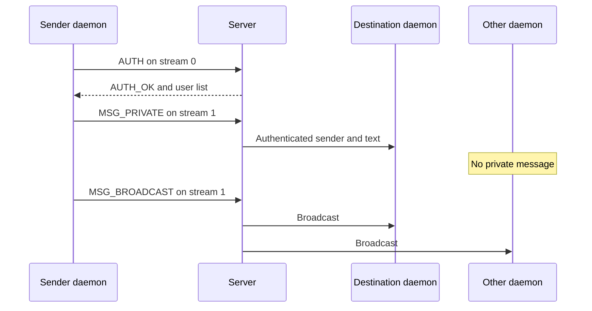
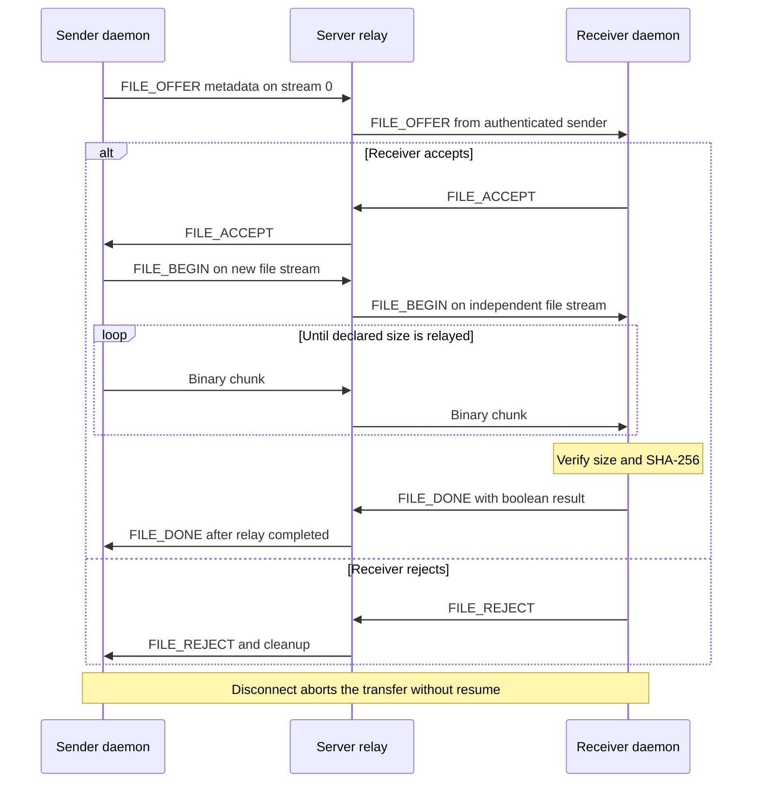

# B application sequences

Source of behavior: client/client.py, server/server.py and server/router.py on the B implementation branch.

## Chat routing

## File lifecycle

For a zero-byte file, BEGIN completes the relay and receiver verifies the empty-file hash without waiting for a chunk. After a peer disconnect or inactivity deadline, the relay notifies the remaining participant with FILE_ERROR and removes application state. Transport buffer cancellation remains pending A5.
