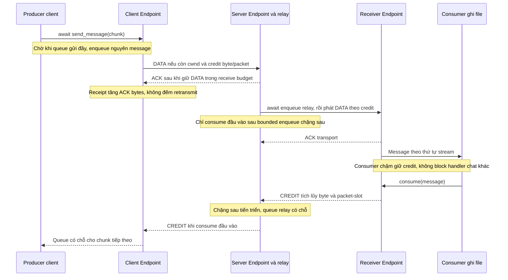

# Backpressure A5 — wire v2

Đã triển khai ở transport và adapter producer/relay tối thiểu. B3/B5 hoàn thiện file state, upload và UI. [Bàn giao A5](../A5-flow-control.md).

CREDIT bị mất được phục hồi qua probe; update cũ/trùng không cộng credit lần hai. ACK chặng đầu không phải FILE_DONE. File được cấp tối đa connection budget trừ reserve control/chat; scheduler giữ lượt file ngay cả khi chat liên tục.
