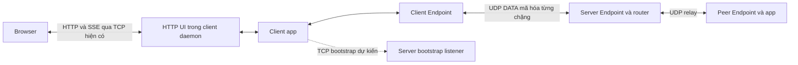
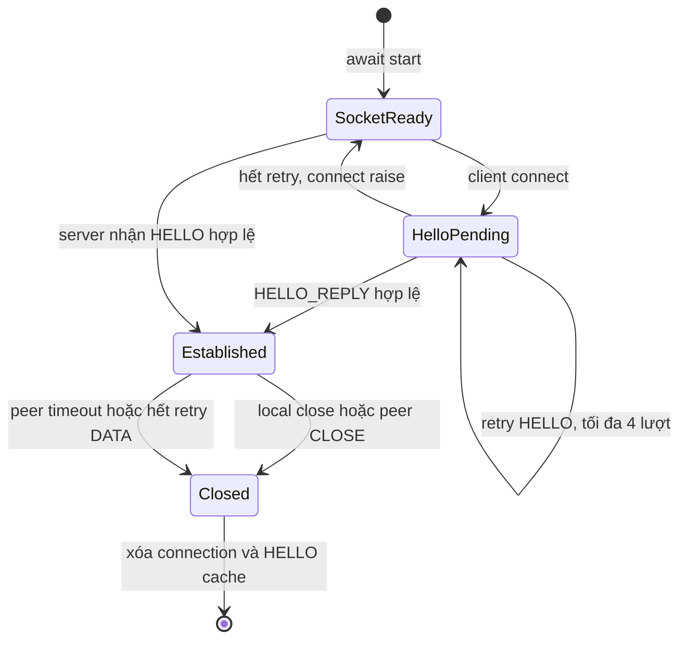
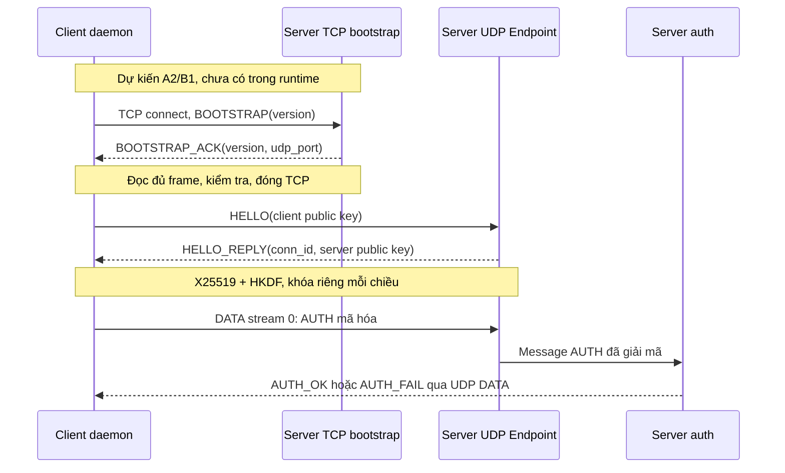
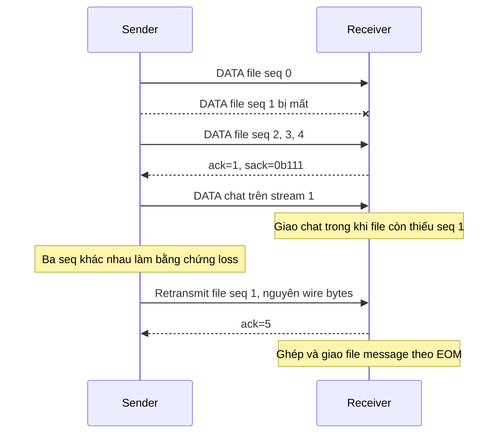

# Sơ đồ transport — A1

Ngày 09/11/2026. Nguồn hành vi và hợp đồng: [protocol](../protocol.md). A phụ trách kiến trúc/state/handshake/loss; B phụ trách sequence chat/file ứng dụng.

Cập nhật A2, 10/11/2026: module TCP bootstrap và test harness TCP → UDP → login/chat đã chạy; các nhãn bootstrap “dự kiến” trong sơ đồ chỉ phần tích hợp production B1 chưa thực hiện. Xem [bàn giao A2](../A2-bootstrap.md).

## Kiến trúc (TCP bootstrap là phần dự kiến)

Server đọc plaintext để routing/relay; không phải mã hóa E2E.

## State logic hiện tại (không phải enum trong code)

Endpoint có thể giữ nhiều connection; state trên chỉ mô tả một phiên. Server on_connect xảy ra khi tạo connection, chưa phải login thành công. Close hiện không chờ CLOSE ACK.

## Handshake mục tiêu A2 + B1

Sai version/oversize/timeout bootstrap phải thất bại rõ ràng, không đi thẳng UDP. UDP HELLO có retry riêng; reconnect do B chạy lại cả bootstrap, UDP và auth.

## Loss/recovery mục tiêu A3/A7

Test HoL phải cố ý giữ lỗ hổng tới khi chat được giao; hình trên không phải bằng chứng test đã chạy. ACK trùng không phải bằng chứng loss mới. Tail loss không có ba packet sau thì dùng RTO. Không bảo đảm chat latency không đổi vì cwnd vẫn dùng chung.
